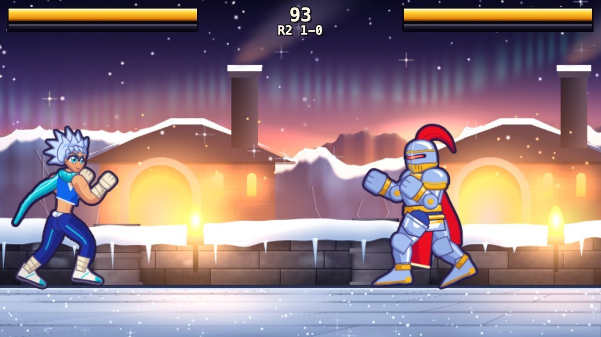
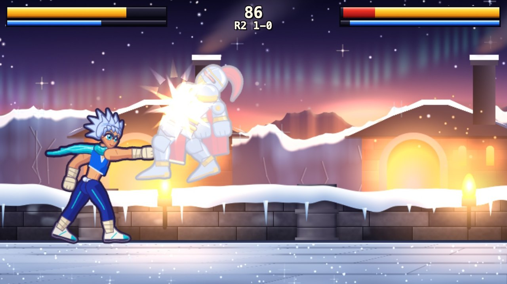

# Arcade Fighter

An original 2D one-on-one arcade fighting game for macOS, written in Swift with SpriteKit and SwiftUI. All fighters, stages and moves are original. The simulation is deterministic and runs at a fixed 60 ticks per second, and the core builds and tests on Linux as well as macOS.





## Features

- **Four fighters**, each with four normals, specials, a super and a throw:

  | Fighter | Style | Health |
  |---|---|---|
  | Kestrel Vane | Rushdown | 900 |
  | Bruno "Anvil" Okafor | Grappler | 1150 |
  | Sister Ilse | Zoner | 950 |
  | Rook | Armor / counter | 1000 |

- **Two stages:** Glacier Forge Quarry and Bell Tower Cloister.
- **Arcade:** a three-fight ladder against the CPU, at easy, then normal, then hard.
- **Versus:** two players on one Mac (keyboard + keyboard, or keyboard + gamepad).
- **Matches:** first to win two rounds, a 99-second round timer, and a super meter that must be full to fire a super.
- **Settings:** fullscreen, integer window scale, and master volume.
- **Key test:** outside a fight, the **Key test…** button (top right) shows which player and button each key maps to, and lets you switch Player 2's attack keys between the numpad and I/O/K/L.
- **Offline:** the app runs in the App Sandbox with no network entitlements.

## Controls

| | Move / jump / crouch | Light Punch | Heavy Punch | Light Kick | Heavy Kick |
|---|---|---|---|---|---|
| Player 1 | W A S D | F | G | H | J |
| Player 2 (default) | Arrow keys | Numpad 4 | Numpad 5 | Numpad 1 | Numpad 2 |
| Player 2 (alternate) | Arrow keys | I | O | K | L |
| Gamepad (drives Player 1 when connected) | D-pad or left stick | X | Y | A | B |

- **Block:** hold back to block high and mid attacks, or crouch to block low and mid attacks.
- **Throw:** Light Punch + Light Kick together, up close.
- **Menus:** arrows or WASD to move, Return or Space to confirm, Esc to go back.
- **Pause:** P or Esc during a fight.

### Move list

Motions use numpad notation, written for a fighter facing right: 2 = down, 3 = down-forward, 6 = forward, 4 = back, 1 = down-back. For example, 236 means down, down-forward, forward. **P** means either punch and **K** either kick.

| Fighter | Specials | Super (full meter) | Throw |
|---|---|---|---|
| Kestrel | Rime Slide 236+LK/HK, Crag Hook 623+LP/HP | Whiteout Line 236236+P | Ice Toss |
| Bruno | Forge Quake 214+P, Bellows Lift 236+K | Anvil Drop 236236+P | Slag Throw |
| Ilse | Prayer Bead 236+LP/HP, Vesper Step 214+LK/HK | Rosary Storm 236236+P | Throw |
| Rook | Rocket Jab 236+LP/HP, Guard Protocol 214+P | Overclock Barrage 236236+K | Throw |

## Requirements

- **To play:** macOS 14 Sonoma or later.
- **To build the app:** Xcode 16.4 on macOS 15 or later (the version CI uses).
- **To build and test the core only:** Swift 6.1 on macOS or Linux (CI uses `swift:6.1.3-noble`).

There is no prebuilt download yet. Build it from source as below.

## Build and run

```bash
git clone https://github.com/rlancaster243/arcade-fighter-public.git
cd arcade-fighter-public
open ArcadeFighter.xcodeproj
```

In Xcode, select the **ArcadeFighter** scheme and press Run (⌘R).

To build from the command line the way CI does (Release, ad-hoc signed, no developer certificate needed):

```bash
xcodebuild build -project ArcadeFighter.xcodeproj -scheme ArcadeFighter \
  -configuration Release -destination 'generic/platform=macOS' \
  -derivedDataPath build/DerivedData CODE_SIGNING_ALLOWED=NO
codesign --force --deep --sign - --entitlements App/ArcadeFighter.entitlements \
  build/DerivedData/Build/Products/Release/ArcadeFighter.app   # ad-hoc sign with the sandbox entitlements
open build/DerivedData/Build/Products/Release/ArcadeFighter.app
```

## Tests and headless simulation

```bash
cd FightCore
swift test --parallel   # unit, content, and integration tests (deterministic replay hashes)
swift run FightSim --p1-fighter kestrel --p2-fighter bruno --seed-start 1 --seed-end 20 --p1 hard --p2 hard --stage stage1 --quiet
```

`FightSim` runs seeded CPU-vs-CPU matches without the app and prints a JSON report. Run `swift run FightSim --help` for options.

## Project structure

| Path | What it holds |
|---|---|
| `FightCore/Sources/FightCore` | Deterministic simulation: input buffer and motions, fighter state machine, collision, match rules, CPU AI, content loading |
| `FightCore/Sources/AppLogic` | Platform-free app logic: menus, key mapping, match setup, render math |
| `FightCore/Sources/FightSim` | Headless batch simulator CLI |
| `FightCore/Tests` | Unit, content, and integration tests |
| `App/` | macOS app: SwiftUI shell, SpriteKit renderer, keyboard and GameController input, audio |
| `Content/` | Fighter, stage, and audio bundles (JSON data + PNG/WAV assets) |
| `Fixtures/Replays/` | Recorded inputs for replay tests |
| `scripts/art`, `scripts/audio` | Generators for the sprite sheets and stage art; the script that prepares the CC0 sound clips |
| `scripts/playtest` | macOS scripts to build, launch, drive, and screenshot the app |
| `docs/` | Fighter data schema and balance notes |

## Credits

- **Art:** fighter sprite sheets and stage backgrounds are generated by the scripts in `scripts/art/`.
- **Audio:** five hit/block/throw/KO sounds are trimmed excerpts of CC0 packs from OpenGameArt. The rest are synthesized. Sources and notices are in [`Content/Audio/CREDITS.md`](Content/Audio/CREDITS.md).
- **Font:** HUD text uses the macOS system font Menlo.

## How it was built

Russell Lancaster directed the project and reviewed and merged the work. The code was written by a team of AI coding agents (Cursor agents and Claude) working in parallel lanes, with a shared simulation contract and CI on every pull request. The commit history shows each contributor.

## License

Code is released under the [MIT License](LICENSE). The CC0 audio excerpts stay under CC0. Their notices are kept in `Content/Audio/CREDITS.md`.
